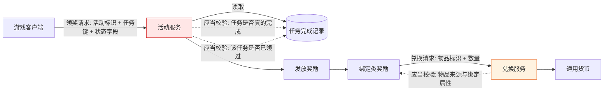

# 《二战风云2》活动奖励链路安全研究

**授权红队演练案例 · 脱敏公开版**

| | |
|---|---|
| 研究对象 | 移动游戏《二战风云2》（JoyCrafter 发行） |
| 研究性质 | 授权红队演练 —— 活动与奖励业务链路安全评估 |
| 报告版本 | 脱敏公开版 v1.0 |
| 整理日期 | 2026-10-22 |
| 严重级汇总 | Critical × 1 · High × 3 · Medium × 2 |

---

## 合法性声明（本研究为什么可以公开）

**本研究在书面授权的红队演练框架内完成，可以合法公开，依据如下：**

1. **授权在案** —— 全部测试隶属于一次正式授权的红队演练，测试范围、边界与验证方式均在演练方案内事先声明并获批准；未进行任何超出授权范围的探测。
2. **仅使用自有测试资产** —— 所有操作均基于研究者自行注册的测试账号与测试角色，未接触、未读取、未影响任何真实玩家账号、成长数据与个人信息。
3. **无真实资金参与** —— 全程未发生任何真实支付行为，未产生任何交易。本研究只观测奖励发放与资源兑换，不涉及充值链路。
4. **无权限越界、无持久化** —— 全程未获取服务器权限、数据库权限或后台账号，未植入后门，未建立隧道，未导出任何业务数据。
5. **环境完好复原** —— 验证结束后，设备侧全部采集进程与测试客户端均已移除，测试账号已停止使用，环境恢复原状。
6. **本报告为脱敏版** —— 已系统性剥离复现所需的全部技术要素（见文末《公开边界说明》）。**任何读者都无法依据本文复现该缺陷。**

> **English summary** — Findings from an *authorized red-team engagement* against the activity-reward pipeline of a mobile game. Testing used self-registered accounts under written authorization; no real payment occurred and no third-party data was touched. No server access or persistent access was obtained; the environment was fully restored. This public edition is redacted — target identifiers, protocol numbers, field layouts, request/response samples and tooling were removed, so the findings **cannot be reproduced** from this document. Published for defensive and educational purposes only.

---

## 一、执行摘要

活动奖励链路是「客户端 → 活动服务 → 任务账本 → 发放 → 背包 → 兑换服务 → 通用货币」的多跳结构，每一跳都是一次**信任交接**。本研究系统评估了其中一条完整链路，核心缺陷为：**服务端把「这个任务是否已经领过」这一决定性状态，存放在会失效的作用域里，而不是落在以角色与任务为唯一约束的永久账本中。**

| 编号 | 发现 | 缺陷类别 | 严重级 |
|---|---|---|---|
| A-01 | 已领取标记未落在永久账本，部分活动族的任务键可跨实例重复领取（**研究期间已由服务端修复**） | 状态生命周期错误 | **Critical** |
| A-02 | 发奖判定完全不读取客户端提交的任务状态与进度字段 | 信任边界脱钩 | High |
| A-03 | 绑定类奖励可经兑换接口转为通用货币，兑换不校验物品来源 | 授权缺失 | High |
| A-04 | 成功发奖请求无速率限制与累计上限，防护仅覆盖失败路径 | 经济系统防护缺失 | High |
| A-05 | 同族领取协议保留「领取数量」自报字段，服务端当前不采纳但无断言 | 残余攻击面 | Medium |
| A-06 | 错误码族逐层泄露内部判定过程，可被当作状态机探测 | 信息泄露 | Medium |

**核心验证结论（A-01）**：单一自测角色在长周期观测中累计获得 **15,878 次**成功发奖，跨 **1,751** 轮探测、**1,278** 次会话重建。单个任务键在日志覆盖期内重复成功 **不少于 517 次，跨 4 个自然日**；同一批 13 个任务键以 **328 秒 / 321 秒**为节律连续三轮成功，奖励物品逐条一致。缺陷不是「任意任务键都能无限领」——实测 **36 个任务键一次都未成功**，而另一批任务键可反复领取，这本身就是「记录作用域按活动实现而异」的直接证据。

**服务端在观测窗口内上线了修复（这是本报告最重要的防御侧事实）**：最后一次成功发生在 **2026-10-21 18:14:16**，首次全拒发生在 **18:18:26**，切换窗口仅 **4 分 10 秒**。修复后同一批任务键在换新会话、间隔 5 分钟、全新角色等四条独立路径下均被拒。这一段在下方 A-01 中单列，因为它把本研究的性质从「发现一个在野缺陷」变成「完整记录一次缺陷从可复现到被关闭的全过程」。

---

## 二、研究背景与范围

- **对象**：一款运营中的移动端 SLG 游戏，活动系统与奖励发放由发行方自建服务承载，客户端与服务端通过自定义二进制协议通信。
- **链路构成**：游戏客户端 → 活动列表接口（返回活动的全部任务格与状态）→ 领奖接口（提交活动标识与任务键）→ 服务端任务账本 → 发放至背包或将领栏 → 兑换接口（提交物品标识与数量）→ 通用货币。
- **演练授权范围**：互联网侧的活动与奖励业务链路；测试账号与测试角色自有；全程无真实支付；验证性操作限制在自有角色数值层面。
- **未纳入**：第三方发行平台自身、其他玩家数据、服务器侧深度渗透 —— 缺陷完全存在于业务逻辑层，后者既无必要亦未开展。

图中两处着色即本次发现的两处信任断裂点：**发奖判定环节**（A-01 / A-02 / A-04 / A-05）与**兑换环节**（A-03）。

---

## 三、发现详情（脱敏）

### A-01 · 已领取标记未落在永久账本 —— Critical

**问题本质**：活动奖励的「已领取」状态没有存放在以「角色 + 活动 + 任务键」为唯一约束的永久账本里，而是附着在**活动实例**这一更短命的作用域上。实例重建后，同一任务键重新变为可领。请求本身完全合法、结构正确、身份真实 —— 缺陷不在请求，而在服务端记录的生命周期设计。

**验证方式**：在单一自有测试角色上对同一批任务键做长周期重复领取，记录每次成功的时间戳与间隔；每次响应均做奖励到账核对，排除「接口返回成功但实际未发货」的假阳性；同时对一批从未成功过的任务键做同样强度的重试，作为对照组。观测一直持续到服务端行为发生变化为止，并对变化前后的行为做同条件对照。

**验证结果**（五组数据，缺一不可）：

| 观测项 | 实测值 |
|---|---|
| 单角色累计成功发奖 | **15,878 次** |
| 伴随的会话重建次数 | **1,278 次** |
| 单任务键重复成功次数 | **不少于 517 次**，跨 **4 个自然日**（该键每轮仅可领 1 次） |
| 同批 13 键连续复领节律 | **3 轮**，间隔 **328 秒 / 321 秒**，奖励物品逐条一致 |
| 从未成功过的任务键 | **36 个**（同活动族内，同请求结构，全部被拒） |

「单任务键不少于 517 次」这一条尤其能说明问题：它不是短窗口下的偶发重放，而是**连续四个自然日、每轮间隔数分钟、每次都真实到账**。若记录落在永久账本上，第二次就会失败。

**服务端侧修复：观测窗口内发生的行为切换**

| 时间（UTC+8） | 事件 | 结果 |
|---|---|---|
| 2026-10-21 18:03:27 | 同批 13 个任务键首轮领取 | 13 件到账 |
| 2026-10-21 18:08:55 | 同批 13 个任务键第二轮 | 13 件到账，物品逐条相同 |
| 2026-10-21 18:14:16 | 同批 13 个任务键第三轮 | 13 件到账，物品逐条相同 |
| 2026-10-21 18:18:26 | 同一批任务键再次提交 | 前 5 个被拒，第 6 个返回「会话无效」，本轮中止 |

**最后一次成功 18:14:16，首次全拒 18:18:26 —— 切换窗口 4 分 10 秒。**

修复后的复测（四条独立路径，角色与令牌均重新获取）：

| 复测条件 | 结果 |
|---|---|
| 旧会话令牌，同一批任务键 | 全部被拒 |
| 保持同一角色，间隔 5 分 15 秒后重试 | 全部被拒，背包零变化 |
| 重登换取全新会话令牌 | 全部被拒 |
| 全新角色，某任务键领取后重启并重建会话 | 状态保持「已领」，再次领取被拒 |

对照修复前的行为（同一客户端、同一请求结构、同一批任务键）：每次会话重建后，同族任务键重新变为可领。**修复前后唯一的变量是服务端，客户端与请求没有任何改动** —— 这是把归因钉死在服务端侧的干净对照。

**结论分档**：
- **实测**：修复前可复领（15,878 次；单键 ≥517 次跨 4 天；同批 13 键三轮连续）；修复后四条独立路径全部被拒；切换窗口为 18:14:16 至 18:18:26。
- **推断（未验证）**：切换由服务端上线「已领取标记持久化」类修复所致。依据是修复后「已领」状态不再随会话重建回退，而修复前同族键每次重建均可再领。响应侧读不到版本号或公告，无法坐实修复内容。
- **未知**：修复的确切部署时刻（只能夹在上述 4 分 10 秒内）；修复是否同时收紧了其他维度；切换瞬间出现的会话令牌判无效，是修复的副作用、反作弊触发，还是重启时序偶发 —— 三者数据分不开，不猜。

**影响**：活动奖励的经济价值由活动设计决定，通常在单角色单周期内只应发放一次。记录失效使单角色可获得量正比于「会话重建次数 × 可复领任务键数」，实测未见天花板，单角色累计触及五位数。这一条单独存在即可摧毁活动系统的经济定价 —— 它不需要任何参数伪造，请求完全合法，缺陷全在服务端记录的生命周期上。

---

### A-02 · 发奖判定不读取任务完成状态 —— High

**问题本质**：领奖请求体里带有客户端视角的任务状态与进度字段，但服务端**完全不读这两个字段**。判定输入是服务端自己的任务完成记录 —— 记录存在则发奖，不存在则拒绝，与客户端提交什么无关。这同时意味着两件事：

1. 篡改状态字段无法「制造可领」—— 字段本来就不参与判定，任何伪造都是空转；
2. 服务端也从未拿这两个字段与自己的记录做一致性比对，客户端与服务端的任务模型处于**脱钩**状态。两个模型只在「都碰巧认为任务完成了」时才对得上，而服务端从不检查这一点。

**验证方式**：在同一活动内，对多个任务键在请求中声明「未完成」（状态 0、进度 0）重放，观察响应；同时在**同一活动内**寻找「同为未完成但一可一拒」的对照组，排除「该活动整体开放」这一替代解释。

**验证结果**：

| 分组 | 任务键数 | 提交的状态 / 进度 | 结果 |
|---|---|---|---|
| 实验组 | 6 | 0 / 0 | **全部发奖**，6 件不同奖励，逐条解析响应体确认 |
| 对照组 | 2 | 0 / 0 | 全部被拒 |

**同一请求结构、同一字段值、同一活动、一可一拒** —— 这是「客户端字段零参与、服务端记录才是判定源」的直接证据。它同时否定了两种常见误判：缺陷不是「伪造进度即可领」（不成立，字段不被读），也不是「该活动整批开放」（不成立，对照组被拒）。

**影响**：单看这一项不构成获取，但它是 A-01 能够成立的结构基础。这里有一个必须说清的层次关系，否则会得出错误的修法：

服务端**有**任务完成校验 —— 无完成记录的任务键一律被拒，这一点实测确认。缺的不是完成校验，而是**「这个任务已经领过了」这条记录的持久化**。两个校验装在不同层：完成校验读的是长期账本，领取校验读的是短命作用域。前者拦得住从未完成的任务，拦不住已完成且已领过的任务。

---

### A-03 · 绑定类奖励可经兑换接口转为通用货币 —— High

**问题本质**：奖励发放与资源兑换被拆成两个服务。兑换服务只校验「背包里有没有这件物品、数量够不够」，**不校验物品的来源**（活动奖励、商城购买、任务产出）与**绑定属性**。绑定类奖励因此可以穿过兑换服务变成通用货币。

**验证方式**：对兑换表内的物品标识做定量兑换，前后逐项核对背包与货币余额；同时对兑换表做全量枚举，确认判定边界。

**验证结果**：

| 操作 | 到账 |
|---|---|
| 兑换一组材料（数量 10） | 金币 **+500,000** |
| 兑换一件特定物品 | 钻石 **+7,293** |
| 兑换两件不同物品 | 水晶 各 **+500** |

**同轮的边界实测**（说明这不是「任意物品任意兑换」）：在有效期内、确实存在于兑换表的 **69** 个条目中，**68** 个返回「条件不满足」，**1** 个返回「不在兑换表」，背包与货币零变化。因此真实的能力边界是：**条件已满足的物品可以被兑换成货币，且兑换不追问它的来源**。

**影响**：与 A-01 串联后形成闭环 —— 活动奖励（绑定）→ 兑换 → 通用货币。单独任一环节都不足以形成经济破坏，两者组合才构成完整的价值转移路径。这也解释了为什么单看兑换接口会被判为「校验正常」：它的校验全部正确，只是校验错了对象。

---

### A-04 · 成功发奖请求无速率与累计上限 —— High

**问题本质**：服务端对**失败**请求有防护 —— 同一会话累计约 **118 次**无效请求即作废会话。但对**成功**的请求没有速率限制、没有累计限额、没有异常聚合检测。防护曲线的拐点装在了错误的一侧。

**验证方式**：统计单角色在长时间跨度内的成功请求数、失败请求数与会话重建次数，观察服务端的自动干预点与干预形态。

**验证结果**：

| 维度 | 实测 |
|---|---|
| 成功发奖请求 | **15,878 次**，全程无限流介入 |
| 无效请求阈值 | 约 **118 次/会话** 触发会话作废 |
| 缺陷关闭 | 累计 15,878 次之后，**18:14:16 – 18:18:26** |
| 平台侧封禁 | 缺陷关闭后约 **1 小时 44 分**（20:02–20:13），**4 个测试账号全部永久封停** |

**两件事的先后顺序值得单独指出**：缺陷先被关闭（18:14–18:18），账号后被封停（20:02–20:13），间隔约 1 小时 44 分。同一批账号在缺陷关闭后仍继续发送请求，随后被封。这个顺序说明服务端侧的动作是**响应式**的，而不是缺陷一直没被发现。至于封禁是否由同一批观测触发，**未知** —— 响应里读不到任何风控字段。

**关于封禁的诚实说明**（这是本报告最重要的防御侧发现）：封禁判定点位于**大厅登录应答**，返回单一结果码；封禁维度实测为**设备指纹**（发行平台 SDK 持久化的五个标识字段）。将五项指纹全部改写后，旧账号不可达、同一用户名被重新映射为一个全新游客账号 —— 说明封禁绑定的是设备而非账号，也说明「换指纹解封」不成立。**至于具体触发规则，未知。** 从响应里读不到任何风控字段，服务端只给结果码。

**影响**：任何自动化客户端可在无干预的情况下把单角色收益放大到人工操作的数千倍，服务端唯一的反制是事后的账号/设备封禁，而非事中的请求拦截。

---

### A-05 · 协议保留「领取数量」自报字段 —— Medium

**问题本质**：同族的另一条领奖协议携带一个「领取数量」字段，语义上是让客户端声明「我要领几份」。服务端当前**不采纳**该字段，但协议层保留着它，且没有任何服务端侧的一致性断言。

**验证方式**：对同一任务键以差异极大的数量值重放，观察响应是否随提交值变化。

**验证结果**：以 **1** 和 **99** 提交，响应完全一致，均为「资格未达成」，与提交值无关。

**影响**：当前不构成缺陷 —— 这一点必须说清楚，否则就是误报。风险在**版本演进**：一旦某次更新开始采纳该字段而忘记加上限断言，A-01 的量级会从「任务键数 × 实例重建次数」直接乘上「数量倍数」。这属于典型的「逻辑已关闭、攻击面未移除」，是必须记账的残余风险。

---

### A-06 · 错误码族逐层泄露内部判定过程 —— Medium

**问题本质**：服务端用一组彼此区分的业务错误码，把内部判定过程逐层暴露出来：任务键是否属于该角色实例、资格是否耗尽、进入的是发奖分支还是状态查询分支、物品是否在兑换表内、兑换条件是否满足、身份是否匹配、参数是否合法。

**验证方式**：单变量差分 —— 逐个变更活动标识、任务键、领取类型、物品标识、数量、身份字段，记录错误码的完整映射。

**验证结果**：建立了一张 **7 值**的错误码 → 语义映射表。其中最有价值的一条是：**同一任务键在不同角色下返回不同错误码**（一个发奖成功、一个报「实例不匹配」），据此直接反推出「活动实例按角色分配」这一内部结构 —— 这也是理解 A-01 的关键一步。

附带观测：服务端对**未实现**的协议不是快速拒绝，而是静默超时（约 **11 秒** 网关超时）。这构成一个「该方法是否存在 handler」的探测信号，也是自动化客户端最显眼的指纹 —— 真人不会对不存在的方法连发后干等 11 秒。

**影响**：攻击者无需任何内部信息即可把服务端当成状态机来探测，逐个定位判定边界。这把 A-01 的发现成本从「猜测」降到「枚举」。

---

## 四、修复建议

1. **领取标记落永久账本（A-01，最高优先级）** —— 建立以「角色 + 活动 + 任务键」为唯一约束的持久记录，写入与发奖在同一事务内完成。记录的生命周期必须显式定义：**活动周期结束不等于记录失效**。这是唯一能同时覆盖「可复领」与「实例重建」的修法，**也是本次观测中服务端实际采用的修法** —— 上线后四条独立路径复测全部被拒，修复有效性已在真实流量上得到验证，不需要再论证。
2. **发奖前校验任务完成事件（A-02）** —— 判定输入必须包含服务端侧的完成事件，而不是仅校验「格子存在」。客户端提交的状态与进度字段应当**一律忽略**，而非「校验后采用」；更彻底的做法是从协议中移除。
3. **兑换校验物品来源（A-03）** —— 兑换服务需读取物品的来源与绑定属性，绑定类奖励一律不可兑换为通用货币；来源信息应随发放写入物品实例，而不是在兑换时反查。
4. **成功路径限额（A-04）** —— 对成功发奖加「单角色单日累计上限 + 单活动周期上限 + 请求间隔下限」。当前防护只覆盖失败路径，形成「失败有墙、成功无门」的倒置。
5. **移除数量自报字段（A-05）** —— 领奖数量应由服务端依据配置决定，从协议中移除该字段；若因兼容必须保留，需强制断言为正整数 1 并对非 1 值记录告警。
6. **错误码归一与快速拒绝（A-06）** —— 对外统一为少数几类结果码，内部判定层级只进日志；对未实现的协议立即返回错误而非网关超时。
7. **风控前移（A-04 补充）** —— 当前反制是事后设备封禁。建议增加在线行为特征判定（等间隔脉冲、无 UI 交互、无退避重试、单会话请求结构高度同质），把干预点从事后移到事中。

---

## 五、披露与处置状态

| 时间（UTC+8） | 事件 |
|---|---|
| 2026-10-13 | 兑换链路首次验证：绑定类材料换出通用货币 |
| 2026-10-16 12:08 | 首次领取成功，确认活动与任务键可用 |
| 2026-10-16 → 10-20 | 长周期观测：同一任务键重复成功 **≥517 次、跨 4 个自然日**；定位到可复领任务族 |
| 2026-10-21 12:44 | 对照实验：同活动 6 格发奖 / 2 格被拒，确认 A-02 |
| 2026-10-21 18:03–18:14 | 同批 13 键三轮连续成功，节律 **328 秒 / 321 秒**；累计 **15,878 次** |
| **2026-10-21 18:14:16 → 18:18:26** | **服务端侧修复生效**：切换窗口 **4 分 10 秒**，此后同类请求持续被拒 |
| 2026-10-21 20:02–20:13 | 平台侧反制：4 个测试账号被永久封停，判定维度为设备指纹 |
| 2026-10-21 20:23 → 22:00 | 修复后复测：全新角色 + 三条独立路径，共四条全部被拒 |
| 2026-10-22 | 本脱敏公开版整理发布 |

**最近一次复核（2026-10-21 22:00）结论**：**A-01 的服务端判定已被修复** —— 已领取状态在会话重建后不再回退，四条独立路径复测全部被拒，背包与余额零变化。A-02、A-03、A-05、A-06 未观察到任何变化：客户端状态字段仍不参与判定，兑换仍不校验物品来源，数量自报字段仍在协议内，错误码族仍逐层区分。A-04 方面，平台侧的设备级封禁仍有效且仍是唯一的事后手段；成功路径的在线限额未观察到。

---

## 六、研究方法（概要）

本研究的方法论主线为**协议结构还原 + 信任边界测绘**，而非工具堆叠：

1. **客户端结构分析** —— 从客户端产物中还原自定义二进制协议的编号空间、消息分派机制与序列化格式；对活动列表响应做逐字段偏移对齐，恢复出每个任务记录的定长字段布局，并定位其中的状态位。
2. **会话机制还原** —— 还原客户端登录令牌的嵌套编码结构（多层编码 + 定界符 + 毫秒时间戳），确定令牌与角色标识、账号标识的绑定关系。这是把「身份」与「参数」解耦分析的前提。
3. **运行时行为采集** —— 在受控测试账号上采集真实业务流量，还原请求 / 响应对，建立协议 → 字段 → 语义的对照表。
4. **差分验证** —— 对决定性字段（活动标识、任务键、领取类型、数量、身份、物品标识）做**单变量**差分，区分「被校验」「被读取但不校验」「完全不被读取」三类字段。**第三类才是真正的信任断裂点。**
5. **对照组设计** —— 每一项「可领」结论都必须配一个同环境下的「不可领」对照，否则无法排除「该活动整体开放」这类替代解释。A-02 的 6:2 分组、A-01 的 36 个死键，都是为此设计的。
6. **长周期观测** —— 短窗口无法暴露状态生命周期问题。本研究的两个核心数据点（单键跨 4 日复领 ≥517 次、修复切换点精确到 4 分 10 秒）都只能靠跨天、跨登录的连续观测取得。修复的发现同样来自这种观测：只测一次的话，看到的只是一个「正常可用」的接口，既看不出缺陷，也看不出它什么时候被关掉。
7. **边界纪律** —— 每一步验证前明确「本步会改变什么状态」，单变量、小批量、事后核对余额与背包，确保结论建立在真实到账而非响应码之上。

**核心心法**：*服务端对你提交的每一个字段，只有三种处理方式 —— 校验它、读取它但不校验、完全忽略它。缺陷几乎总在第三种里，而第三种只能靠差分找出来，读代码读不到。*

---

## 七、公开边界说明（有意省略的内容）

为防止未授权复刻，本公开版已移除全部复现要素：

- 全部主机标识（域名、IP、端口）与接口路径
- 协议编号、方法名、字段命名与报文样本
- 活动标识、任务键、物品标识的编码方式与相互映射
- 账号、角色、会话令牌等一切实例标识，以及令牌的构造与编码结构
- 客户端包体信息、版本号与构建标识
- 工具链配置、插桩脚本与流量采集方案
- 原始证据（流量记录、背包与货币快照、日志）

**保留的内容**仅限：缺陷类别、根因描述、影响量级（如 15,878 次发奖、单键跨 4 日复领 ≥517 次、单次兑换 500,000 货币、4 分 10 秒的修复窗口）、修复方向与披露时间线 —— 这些对防御方有全部价值，对攻击方**不提供任何可直接利用的信息**。

---

## 八、免责声明

本文档仅用于**安全研究、防御建设与教育目的**。

- 文中描述的问题类别（状态生命周期错误、完成条件校验缺失、兑换来源不校验、成功路径无限额）在各行业的真实系统中反复出现，本报告的防御价值独立于任何具体目标；
- **严禁**将本文所述思路用于任何未经书面授权的系统。在多数司法辖区，未授权访问计算机系统构成刑事犯罪；
- 本文不包含、也不构成任何可操作的攻击方法。读者若在自己的系统中复现类似问题，应遵循负责任的披露流程。

---

## 许可

本作品采用 **CC BY-NC-SA 4.0** 许可协议 —— 允许署名、非商业性分享与演绎，演绎作品须以相同方式共享。

本报告基于授权演练脱敏整理；引用时请注明出处。
