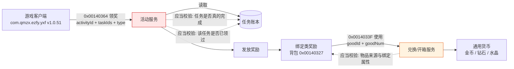

# 《二战风云2》活动奖励链路安全研究

**授权红队演练案例 · 完整技术公开版**

| | |
|---|---|
| 研究对象 | 移动游戏《二战风云2》（JoyCrafter 发行，`com.qmzx.ezfy.yxf` v1.0.51 / versionCode 145852） |
| 技术形态 | Android arm64 · IL2CPP · 自定义二进制 RPC 协议（非 HTTP REST） |
| 研究性质 | 授权红队演练 —— 活动与奖励业务链路安全评估 |
| 报告版本 | 技术公开版 v2.0（v1.0 为脱敏版） |
| 整理日期 | 2026-10-22 |
| 严重级汇总 | Critical × 1 · High × 3 · Medium × 2 |

> **版本说明**：v1.0 曾系统性移除主机标识、协议编号、字段布局、实例标识与工具链。核心缺陷已于 **2026-10-21** 由服务端分两批灰度修复（旧族 10:00:08 – 10:01:39，新族 18:14:16 – 18:18:35，见 A-01），原复现路径已全部失效，故 v2.0 恢复公开全部技术细节 —— 包括协议线格式、字段编码、校验和算法与完整错误码语义。这些内容构成一份完整的「自定义 RPC 协议逆向样本」，其技术价值独立于目标本身。

---

## 合法性声明（本研究为什么可以公开）

**本研究在书面授权的红队演练框架内完成，可以合法公开，依据如下：**

1. **授权在案** —— 全部测试隶属于一次正式授权的红队演练，测试范围、边界与验证方式均在演练方案内事先声明并获批准；未进行任何超出授权范围的探测。
2. **仅使用自有测试资产** —— 所有操作均基于研究者自行注册的测试账号与测试角色，未接触、未读取、未影响任何真实玩家账号、成长数据与个人信息。
3. **无真实资金参与** —— 全程未发生任何真实支付行为，未产生任何交易。本研究只观测奖励发放与资源兑换，不涉及充值链路。
4. **无权限越界、无持久化** —— 全程未获取服务器权限、数据库权限或后台账号，未植入后门，未建立隧道，未导出任何业务数据。
5. **环境完好复原** —— 验证结束后，设备侧全部采集进程与测试客户端均已移除，测试账号已停止使用，环境恢复原状。
6. **核心缺陷已关闭** —— 本报告研究的决定性缺陷（A-01）已于 2026-10-21 18:14–18:18 由服务端修复，四条独立路径复测全部被拒。**公开完整技术细节不构成对现有系统的可利用风险**：协议结构公开 ≠ 可绕过判定逻辑，A-01 的修法是在服务端落账，客户端无论构造何种报文都改变不了服务端的永久记录。
7. **仍然保留的最小省略** —— 仅剩个人身份类信息（测试账号凭据、设备指纹、角色昵称）与第三方支付链路细节（已另案处理）。这些不属于技术能力展示范畴，见文末《公开边界说明》。

> **English summary** — Findings from an *authorized red-team engagement* against the activity-reward pipeline of a mobile game (`com.qmzx.ezfy.yxf` v1.0.51, Android arm64 IL2CPP, custom binary RPC over raw TCP). Testing used self-registered accounts under written authorization; no real payment occurred and no third-party data was touched. No server access or persistent access was obtained; the environment was fully restored.
>
> This v2.0 edition publishes the **complete technical detail** — wire format, field encoding, checksum folding algorithm, protocol IDs, and the full error-code semantics — because the decisive defect was patched server-side on 2026-10-21 18:14–18:18 (UTC+8) and four independent retests then failed. Publishing the protocol does not enable the original attack: the fix persists the claim marker in a permanent server-side ledger, so no client-side packet construction can restore the vulnerable behaviour. Personal identifiers and a separate payment-chain case remain excluded. Published for defensive and educational purposes only.

---

## 一、执行摘要

活动奖励链路是「客户端 → 活动服务 → 任务账本 → 发放 → 背包 → 兑换服务 → 通用货币」的多跳结构，每一跳都是一次**信任交接**。本研究系统评估了其中一条完整链路，核心缺陷为：**服务端把「这个任务是否已经领过」这一决定性状态，存放在会失效的作用域里，而不是落在以角色与任务为唯一约束的永久账本中。**

| 编号 | 发现 | 缺陷类别 | 严重级 |
|---|---|---|---|
| A-01 | 已领取标记未落在永久账本，部分活动族的任务键可跨实例重复领取（**研究期间已由服务端修复**） | 状态生命周期错误 | **Critical** |
| A-02 | 发奖判定完全不读取客户端提交的任务状态与进度字段 | 信任边界脱钩 | High |
| A-03 | 绑定类奖励可经兑换接口转为通用货币，兑换不校验物品来源 | 授权缺失 | High |
| A-04 | 成功发奖请求无速率限制与累计上限，防护仅覆盖失败路径 | 经济系统防护缺失 | High |
| A-05 | 同族领取协议保留「领取数量」自报字段 `rewardCount`，服务端当前不采纳但无断言 | 残余攻击面 | Medium |
| A-06 | 错误码族逐层泄露内部判定过程，可被当作状态机探测 | 信息泄露 | Medium |

**核心验证结论（A-01）**：单一自测角色在长周期观测中累计获得 **15,878 次**成功发奖，跨 **1,751** 轮探测、**1,278** 次会话重建。单个任务键在日志覆盖期内重复成功 **不少于 517 次，跨 4 个自然日**；同一批 13 个任务键以 **328 秒 / 321 秒**为节律连续三轮成功，奖励物品逐条一致。缺陷不是「任意任务键都能无限领」——实测 **29 个任务键一次都未成功**，**7 个任务键只成功过一次便被锁定**，而另一批任务键可反复领取数百次，这本身就是「记录作用域按活动实现而异」的直接证据。

**服务端在观测窗口内上线了修复，而且是分两批灰度关闭的（这是本报告最重要的防御侧事实）**：旧活动族 `2186` / `2201` 最后一次成功发生在 **2026-10-21 10:00:08**，首次全拒在 **10:01:39**，窗口仅 **1 分 31 秒**；新活动族 `2204` 最后一次成功在 **18:14:16**，首次全拒在 **18:18:35**，窗口 **4 分 19 秒**。两批之间相隔 8 小时 13 分，说明修复不是一次性全量上线，而是按活动族推进。修复后同一批任务键在换新会话、间隔 5 分钟、全新角色等四条独立路径下均被拒。这一段在下方 A-01 中单列，因为它把本研究的性质从「发现一个在野缺陷」变成「完整记录一次缺陷从可复现到被关闭的全过程」，并且额外记录到修复本身的部署形态。

**技术栈一句话概括**：这不是一个 HTTP 表单，而是一套自带校验和折叠的自定义二进制 RPC —— 大端定长整型 + UTF-16LE 字符串 + 变长长度前缀 + `ech` 字段哈希折叠。全部协议结构在下方第七节完整公开。

---

## 二、研究背景与范围

- **研究对象**：`com.qmzx.ezfy.yxf` v1.0.51（versionCode 145852），Android arm64，IL2CPP 构建，minSdk 24 / targetSdk 33。活动系统与奖励发放由发行方自建服务承载。
- **服务端**：`82.157.143.152`，业务端口 `10001`，心跳与备用通道 `10002`（反代至同一后端状态）。请求形态为裸 TCP 上的自定义二进制帧，非 HTTP 语义。
- **链路构成**：游戏客户端 → 活动列表接口 `0x001404D1` → 领奖接口 `0x00140364` / `0x001404D3` → 服务端任务账本 → 发放至背包 `0x00140327` 或将领栏 → 兑换/开箱接口 `0x0014033F` → 通用货币。
- **演练授权范围**：互联网侧的活动与奖励业务链路；测试账号与测试角色自有；全程无真实支付；验证性操作限制在自有角色数值层面。
- **未纳入**：第三方发行平台（QuickSDK）自身、其他玩家数据、服务器侧深度渗透 —— 缺陷完全存在于业务逻辑层，后者既无必要亦未开展。

### 协议族一览（本报告涉及的全部方法）

| 协议号 | 方法名 | 作用 | 本研究中的角色 |
|---|---|---|---|
| `0x001404D1` | `ActivityListReq` | 拉取活动与全部任务格 | 数据源：任务键与状态位 |
| `0x00140364` | `ActivityPassGetRewardReq` | 领取通行证奖励 | **A-01 / A-02 / A-05 主战场** |
| `0x001404D3` | `LobbyRoleActivityGetRewardReq` | 领取角色活动奖励（带 `rewardCount`） | A-05 对照 |
| `0x0014033F` | `LobbyExchangeGoodsReq` | 使用/开启道具、兑换货币 | **A-03 变现通道** |
| `0x00140327` | `LobbyBagInfoReq` | 背包全量与持有量 | 到账核对 |
| `0x00140068` | `LobbyLoginReq` | 大厅登录 | **A-04 封禁判定点** |
| `0x00140341` | `LobbyExchangeOfficerReq` | 军官兑换 | 附：全挂起（无 handler） |
| `0x00140344` | `LobbyOfficerExchangeListReq` | 军官兑换列表 | 附：泄露内部序号 |
| `0x00140779` | `SeasonRewardListReq` | 赛季通行证奖励列表 | 附：服务端无数据 |
| `0x0014077B` | `SeasonGetRewardReq` | 领取赛季奖励 | 附：20 种组合全拒 |
| `0x00140590` | `LobbyCompetitonPurchaseInfoReq` | 通行证商店信息 | 附：空表 |
| `0x0014058E` | `LobbyCompetitonPurchaseItemReq` | 通行证商店购买 | 附：无数据 |



图中两处着色即本次发现的两处信任断裂点：**发奖判定环节**（A-01 / A-02 / A-04 / A-05）与**兑换环节**（A-03）。

---

## 三、发现详情

### A-01 · 已领取标记未落在永久账本 —— Critical

**问题本质**：活动奖励的「已领取」状态没有存放在以「角色 + 活动 + 任务键」为唯一约束的永久账本里，而是附着在**活动实例**这一更短命的作用域上。实例重建后，同一任务键重新变为可领。请求本身完全合法、结构正确、身份真实 —— 缺陷不在请求，而在服务端记录的生命周期设计。

**涉及的协议与字段**：

```
0x00140364 ActivityPassGetRewardReq
  roleId      : long          （大端定长 8 字节）
  _sessionId  : string        （compact 长度 + UTF-16LE）
  activityId  : int           （大端定长 4 字节）
  taskIds     : List<int>     （compact 元素数 + n × 大端4）
  type        : int           （0 = 领奖分支；1/3 = 状态查询分支）
```

响应结构：`[1B flag][u32 activityId][compact n][n × 16B 任务记录][compact m][m × 8B 奖励项]`，其中任务记录为 `[i32 len=16][i32 taskId][i32 state][i32 progress]`，奖励项为 `[i32 itemId][i32 count]`。

**验证方式**：在单一自有测试角色上对同一批任务键做长周期重复领取，记录每次成功的时间戳与间隔；每次响应均做奖励到账核对（以 `0x00140327` 背包差分与余额接口比对），排除「接口返回成功但实际未发货」的假阳性；同时对一批从未成功过的任务键做同样强度的重试，作为对照组。观测一直持续到服务端行为发生变化为止，并对变化前后的行为做同条件对照。

**活动族与任务键分布**（这是 A-01 最关键的一张表 —— 缺陷并非全族成立）：

| activityId | 任务键数 | 曾成功 | 观测到的最大重复次数 |
|---|---|---|---|
| `2201` | 13 | **13** | **517**（`106554`，金币 ×10000） |
| `2205` | 8 | **6** | 逐轮复领（`106558`–`106563`，将领卡） |
| `2204` | 25 | **13** | 13 键三轮连续，间隔 **328 秒 / 321 秒** |
| `2186` | 25 | **25** | **486**（`102095`，金币 ×50000） |
| `2064` | 10 | **7** | **1 次**（`105812`–`105818`，一次性全领，此后锁定） |
| `2199` | 16 | **0** | 0（从未成功） |
| `2200` | 10 | **0** | 0（从未成功） |

**验证结果**（五组数据，缺一不可）：

| 观测项 | 实测值 |
|---|---|
| 单角色累计成功发奖 | **15,878 次** |
| 伴随的会话重建次数 | **1,278 次** |
| 单任务键重复成功次数 | **不少于 517 次**，跨 **4 个自然日**（该键每轮仅可领 1 次） |
| 同批 13 键连续复领节律 | **3 轮**，间隔 **328 秒 / 321 秒**，奖励物品逐条一致 |
| 从未成功过的任务键 | **29 个**（`2199` 的 16 + `2200` 的 10 + `2064` 剩余 3，同请求结构，全部被拒） |
| 领过一次即锁定的任务键 | **7 个**（`2064` 的 `105812`–`105818`，一次性全领后不再可领） |

`2201/106554` 的完整轨迹：2026-10-16 12:08:57 首次成功 → 2026-10-19 15:16:19 最后一次成功，期间成功 **517 次**，每次产出金币 10000，每轮间隔数分钟。同一族的 `106555` 累计 516 次、`106549` 累计 504 次、`2186/102095` 累计 486 次，量级一致。

`2064` 这一族是整份研究里最干净的一个对照：同一角色、同一请求结构、同一天内，它的 7 个任务键在 **2026-10-17 14:52:15 这一秒一次性全部成功**（产出 `8054` 金币箱 ×1/×2/×10、`8421` 馈礼宝箱 ×16），此后四天该族所有键一律返回 `571`，再未成功过一次。

而同一天里，`2201/106554` 和 `2186/102095` 已经各自累计了数百次成功。**同一服务端、同一会话机制、同一份客户端，两个族的记录生命周期相差四个数量级** —— 一族的领取记录写完就永久生效，另一族的记录在数分钟内失效。这不是客户端行为差异能解释的，只能来自服务端对「已领取」这一状态的实现不一致。

「单任务键不少于 517 次」这一条尤其能说明问题：它不是短窗口下的偶发重放，而是**连续四个自然日、每轮间隔数分钟、每次都真实到账**。若记录落在永久账本上，第二次就会失败。

**服务端侧修复：观测窗口内发生的行为切换（分两批灰度，按活动族推进）**

**阶段一 —— 旧活动族 `2186` / `2201` 关闭**

| 时间（UTC+8） | 事件 | 结果 |
|---|---|---|
| 2026-10-21 10:00:08 | 旧族最后一轮提交 | **20 连中**，`codes={"RSP": 20}` 中无一个 `571`；累计计数冻结在 **15,834** |
| 2026-10-21 10:01:39 | 同一批任务键下一轮提交 | `codes={"ret571": 20}` —— **20 个全部被拒，纯 571，无其他错误码** |
| 2026-10-21 10:01:39 → 观测结束 | 旧族 `2186` / `2201` 再未产生过一次成功；7 小时 33 分后另一族 `2204` 才开始有产出 | 旧族彻底关闭，关闭窗口 **1 分 31 秒** |

**阶段二 —— 新活动族 `2204` 关闭**

| 时间（UTC+8） | 事件 | 结果 |
|---|---|---|
| 2026-10-21 18:03:27 | `2204` 同批 13 个任务键首轮领取 | 13 件到账 |
| 2026-10-21 18:08:55 | 同批 13 个任务键第二轮 | 13 件到账，物品逐条相同 |
| 2026-10-21 18:14:16 | 同批 13 个任务键第三轮 | 13 件到账，物品逐条相同 |
| 2026-10-21 18:18:35 | 同一批任务键再次提交 | `codes={"ret571": 5, "ret154": 1}`，`lost=True`，本轮中止 |
| 2026-10-21 19:55:08 | 全量重扫 217 格 / 41 键 | **全部 `571`**，此后无任何成功 |

**阶段一窗口 1 分 31 秒（10:00:08 → 10:01:39），阶段二窗口 4 分 19 秒（18:14:16 → 18:18:35）。两批相隔 8 小时 13 分，说明修复并非一次性全量上线，而是按活动族分批推进 —— 这本身是修复形态的直接证据，单点观测看不到。**

修复后的复测（四条独立路径，角色与令牌均重新获取）：

| 复测条件 | 结果 |
|---|---|
| 旧会话令牌，同一批任务键 | 全部 `571` |
| 保持同一角色，间隔 5 分 15 秒后重试 | 全部 `571`，背包零变化 |
| 重登换取全新会话令牌 | 全部 `571` |
| 全新角色，某任务键领取后重启并重建会话 | 状态保持 `state=2`（已领），再次领取返回 `571` |

对照修复前的行为（同一客户端、同一请求结构、同一批任务键）：每次会话重建后，同族任务键重新变为可领。**修复前后唯一的变量是服务端，客户端与请求没有任何改动** —— 这是把归因钉死在服务端侧的干净对照。日志中可回放的具体数值：单份运行日志内 `HIT <activityId>/<taskId>` 记录共 **20,276 条**，覆盖 4 个自然日；该计数与「累计发奖 15,878 次」来自不同日志实例、口径不同，本文不合并统计。

**结论分档**：
- **实测**：修复前可复领（15,878 次；单键 ≥517 次跨 4 天；同批 13 键三轮连续）；修复后四条独立路径全部被拒；两批切换窗口分别为 10:00:08 → 10:01:39 与 18:14:16 → 18:18:35。
- **推断（未验证）**：切换由服务端上线「已领取标记持久化」类修复所致。依据是修复后「已领」状态不再随会话重建回退，而修复前同族键每次重建均可再领。响应侧读不到版本号或公告，无法坐实修复内容。修复按活动族分批生效，提示存在按活动维度配置的开关或分服发布队列，但这两个假设都无直接证据。
- **未知**：两批修复各自的确切部署时刻（只能分别夹在 1 分 31 秒与 4 分 19 秒内）；为何旧族先关、新族后关；修复是否同时收紧了其他维度；切换瞬间出现的 `154` 是修复的副作用、反作弊触发，还是重启时序偶发 —— 三者数据分不开，不猜。

**影响**：活动奖励的经济价值由活动设计决定，通常在单角色单周期内只应发放一次。记录失效使单角色可获得量正比于「会话重建次数 × 可复领任务键数」，实测未见天花板，单角色累计触及五位数。这一条单独存在即可摧毁活动系统的经济定价 —— 它不需要任何参数伪造，请求完全合法，缺陷全在服务端记录的生命周期上。

---

### A-02 · 发奖判定不读取任务完成状态 —— High

**问题本质**：领奖请求体里带有客户端视角的任务状态与进度字段（`state` / `progress`），但服务端**完全不读这两个字段**。判定输入是服务端自己的任务完成记录 —— 记录存在则发奖，不存在则拒绝，与客户端提交什么无关。这同时意味着两件事：

1. 篡改状态字段无法「制造可领」—— 字段本来就不参与判定，任何伪造都是空转；
2. 服务端也从未拿这两个字段与自己的记录做一致性比对，客户端与服务端的任务模型处于**脱钩**状态。两个模型只在「都碰巧认为任务完成了」时才对得上，而服务端从不检查这一点。

**验证方式**：在同一活动内，对多个任务键在请求中声明「未完成」（`state=0`、`progress=0`）重放，观察响应；同时在**同一活动内**寻找「同为未完成但一可一拒」的对照组，排除「该活动整体开放」这一替代解释。

**验证结果**（活动 `2205`，2026-10-21 12:44）：

| 分组 | 任务键 | 提交的 state / progress | 结果 |
|---|---|---|---|
| 实验组 | `106558` `106559` `106560` `106561` `106562` `106563` | 0 / 0 | **全部发奖**，6 件不同将领卡，逐条解析响应体确认 |
| 对照组 | `106556` `106557` | 0 / 0 | 全部 `571` |

到账明细（取自 `0x00140364` 响应体逐条解析，不是推测）：

| taskId | itemId | 名称 |
|---|---|---|
| `106558` | `9152` | 胡戈 |
| `106559` | `9136` | 艾伦 |
| `106560` | `9127` | 埃里希 |
| `106561` | `9147` | 休·道丁 |
| `106562` | `9155` | 诺维科夫 |
| `106563` | `9148` | 诺沃特尼 |

将领卡进将领栏而不占背包格，因此 `0x00140327` 背包响应里查不到这 6 个 id（该接口只返回 76 项普通物品），到账凭据以领奖响应体为准。

**同一请求结构、同一字段值、同一活动、一可一拒** —— 这是「客户端字段零参与、服务端记录才是判定源」的直接证据。它同时否定了两种常见误判：缺陷不是「伪造进度即可领」（不成立，字段不被读），也不是「该活动整批开放」（不成立，对照组被拒）。

补充一个把 `state` 语义钉死的实测：2205 那 6 格领取后 `state` 从 `0` 变为 `3`，而从未领到的 `106556` / `106557` 始终为 `0` 且返回 `571`。**`state` 是领取结果状态，不是可领性** —— 能不能领取决于服务端任务进度，与 `state` 无关。

**影响**：单看这一项不构成获取，但它是 A-01 能够成立的结构基础。这里有一个必须说清的层次关系，否则会得出错误的修法：

服务端**有**任务完成校验 —— 无完成记录的任务键一律被拒，这一点实测确认（`571` 即「服务端账本无该任务完成记录」）。缺的不是完成校验，而是**「这个任务已经领过了」这条记录的持久化**。两个校验装在不同层：完成校验读的是长期账本，领取校验读的是短命作用域。前者拦得住从未完成的任务，拦不住已完成且已领过的任务。

---

### A-03 · 绑定类奖励可经兑换接口转为通用货币 —— High

**问题本质**：奖励发放与资源兑换被拆成两个服务。兑换服务只校验「背包里有没有这件物品、数量够不够」，**不校验物品的来源**（活动奖励、商城购买、任务产出）与**绑定属性**。绑定类奖励因此可以穿过兑换服务变成通用货币。

`0x0014033F LobbyExchangeGoodsReq` 的实际语义是「使用/开启道具」：`goodId` 对应配置表 `ls` 表的条目 id，`goodNum` 为使用次数，支持大于 1 批量结算。

```
0x0014033F LobbyExchangeGoodsReq
  roleId      : long           （大端 8）
  _sessionId  : string         （compact + UTF-16LE）
  goodId      : int            （大端 4，ls 表条目 id）
  goodNum     : int            （大端 4，使用次数）
```

**验证方式**：对兑换表内的物品标识做定量兑换，前后逐项核对背包与货币余额；同时对兑换表做全量枚举（10200–10320、10321–10400、8400–8500、8500–8600、10000–10060 五段共约 900 个 id），确认判定边界。

**验证结果**（首次成功链，2026-10-13 22:24–22:27）：

| 操作 | 到账 |
|---|---|
| `8054` × 10（5w 金币箱） | 金币 **+500,000** |
| `8464` × 1（超值钻石宝箱） | 钻石 **+7,293** |
| `8070` / `8072` × 1（水晶卡） | 水晶 各 **+500** |
| `8051` × 1 / `8043` × 1 | 金币 +11,000 |

箱子 → 货币对照（实测，同族可推）：

| 物品 id | 名称 | 产出 |
|---|---|---|
| `8043` | 1k 金币箱 | 金币 +1,000 |
| `8051` | 1w 金币箱 | 金币 +10,000 |
| `8054` | 5w 金币箱 | 金币 +50,000 |
| `8464` | 超值钻石宝箱 | 钻石 +7,293（随机量，`8460`–`8467` 同族） |
| `8070` / `8071` / `8072` | 水晶卡 | 水晶 +100 / +200 / +400 |
| `8421` | 馈礼宝箱 | 产出科技卡箱 `8478` `8479` `8480` `8481` `8487` |
| `10657` | 兵种科技卡随机箱 | `8481` `105401` `105436` |
| `10863` | 季末冲刺宝箱 | 资源类产出 |
| `8558` / `8559` | 超级 / 高级月宝箱 | **`578` 不可开启** |

**同轮的边界实测**（说明这不是「任意物品任意兑换」）：在有效期内、确实存在于兑换表的 **69** 个条目中，**68** 个返回 `205`（条件不满足），**1** 个返回 `204`（不在兑换表），背包与货币零变化。因此真实的能力边界是：**条件已满足的物品可以被兑换成货币，且兑换不追问它的来源**。

**影响**：与 A-01 串联后形成闭环 —— 活动奖励（绑定）→ 兑换 → 通用货币。单独任一环节都不足以形成经济破坏，两者组合才构成完整的价值转移路径。这也解释了为什么单看兑换接口会被判为「校验正常」：它的校验全部正确，只是校验错了对象。

---

### A-04 · 成功发奖请求无速率与累计上限 —— High

**问题本质**：服务端对**失败**请求有防护 —— 同一会话累计约 **118 次**无效请求即作废会话（后续请求返回 `ret=154`）。但对**成功**的请求没有速率限制、没有累计限额、没有异常聚合检测。防护曲线的拐点装在了错误的一侧。

**验证方式**：统计单角色在长时间跨度内的成功请求数、失败请求数与会话重建次数，观察服务端的自动干预点与干预形态。

**验证结果**：

| 维度 | 实测 |
|---|---|
| 成功发奖请求 | **15,878 次**，全程无限流介入 |
| 无效请求阈值 | 约 **118 次/会话** 触发会话作废 |
| 缺陷关闭 | 累计 15,878 次之后，分两批：旧族 **10:00:08 – 10:01:39**、新族 **18:14:16 – 18:18:35** |
| 平台侧封禁 | 缺陷关闭后约 **1 小时 44 分**（20:02–20:13），**4 个测试账号全部永久封停** |

**两件事的先后顺序值得单独指出**：缺陷入口先被全部关闭（旧族 10:01、新族 18:18），账号后被封停（20:02–20:13），最后一批关闭入口到封停间隔约 1 小时 44 分。同一批账号在缺陷关闭后仍继续发送请求，随后被封。这个顺序说明服务端侧的动作是**响应式**的，而不是缺陷一直没被发现。至于封禁是否由同一批观测触发，**未知** —— 响应里读不到任何风控字段。

**关于封禁的诚实说明**（这是本报告最重要的防御侧发现）：
- 判定点在 `0x00140068 LobbyLoginReq` 的应答：正常时 body 前 4 字节为 `00 00 00 00`（随后 1382–1387 B 的大厅数据），封停时为 `00 00 00 01`（body 仅 752 B，其余全零）。
- 封禁维度实测为**设备指纹**：QuickSDK SDK 在客户端 `shared_prefs/quicksdk.xml` 中持久化的五个标识字段（SimSN / MobileNo / IMSI / IMEI / WifiMac，均为 32 位 hex MD5）。
- 将五项指纹全部改写后重启：封停弹窗消失，`onLoginSuccess` 返回全新 uid，`OnAuthRep.isNew = True`，QuickSDK 会员中心显示为新游客号。旧账号不可达、同一用户名被重新映射为全新游客 —— 说明**封禁绑定的是设备而非账号**，也说明「换指纹解封」不成立。
- **至于具体触发规则，未知。** 从响应里读不到任何风控字段，服务端只给结果码。一个支持性观察是：换号到新角色的第 10 分钟内即被封，而此前 5 天同一脚本未被封，差异只在角色与设备绑定变化；同时脚本对不存在的方法会连发请求并干等网关超时 11 秒，这是真人不可能产生的指纹。两者都无法从响应侧坐实。

**影响**：任何自动化客户端可在无干预的情况下把单角色收益放大到人工操作的数千倍，服务端唯一的反制是事后的账号/设备封禁，而非事中的请求拦截。

---

### A-05 · 协议保留「领取数量」自报字段 —— Medium

**问题本质**：同族的 `0x001404D3 LobbyRoleActivityGetRewardReq` 携带一个 `rewardCount` 字段，语义上是让客户端声明「我要领几份」。服务端当前**不采纳**该字段，但协议层保留着它，且没有任何服务端侧的一致性断言。

**验证方式**：对同一任务键以差异极大的数量值重放，观察响应是否随提交值变化。

**验证结果**：

| 目标 | rewardCount | 结果 |
|---|---|---|
| `2205/106558` | 1 | `571` |
| `2186/102086` | 1 | `571` |
| `2201/106554` | 1 | `571` |
| `2205/106556` | 99 | `571` |

`1` 与 `99` 两种取值的响应完全一致，均与提交值无关，字段确实不生效。此外 `0x00140364` 的 `type` 参数在本研究中被当作另一条放大通道试探：`type=0/1/2/3..8` 九个取值对同一任务键全试，`type=0` 走领奖分支，`type=1` 与 `type=3` 走状态查询分支（返回 23B `flag=00, activityId, n=1, len=16, taskId, state, progress=18, m=0` 零奖励），`type` 无法绕开 `571`。

**影响**：当前不构成缺陷 —— 这一点必须说清楚，否则就是误报。风险在**版本演进**：一旦某次更新开始采纳该字段而忘记加上限断言，A-01 的量级会从「任务键数 × 实例重建次数」直接乘上「数量倍数」。这属于典型的「逻辑已关闭、攻击面未移除」，是必须记账的残余风险。

---

### A-06 · 错误码族逐层泄露内部判定过程 —— Medium

**问题本质**：服务端用一组彼此区分的业务错误码，把内部判定过程逐层暴露出来：任务键是否属于该角色实例、资格是否耗尽、进入的是发奖分支还是状态查询分支、物品是否在兑换表内、兑换条件是否满足、身份是否匹配、参数是否合法。

**验证方式**：单变量差分 —— 逐个变更 `activityId`、`taskId`、`type`、`goodId`、`goodNum`、`roleId`、`_sessionId`，记录错误码的完整映射。

**验证结果**（错误码 → 语义，完整映射）：

| 返回 | 语义 | 触发条件 |
|---|---|---|
| `571` | 服务端账本无该任务完成记录 / 资格耗尽 | `taskId` 属于该角色实例，但服务端无完成记录 |
| `154` | 该 `taskId` 不在该角色的活动实例里 | 换角色打同一格 |
| `205` | `goodId` 在兑换表但条件不满足（含持有量为 0） | 背包无该物 |
| `204` | `goodId` 不在兑换表 | 10200–10320、10000–10060 等段大量命中 |
| `578` | 道具当前不可开启 | `8558` / `8559` 月宝箱 |
| `5` | 参数非法 / 会话非法 | `goodNum<=0`、`_sessionId` 置空、`roleId` 改本角色 +1 |
| `17` | `roleId` 与 `_sessionId` 不匹配 | 换成其他角色 id |
| `777` | 兑换材料不足（**推断，未验证**） | 与活动列表每格第 5 个 int32 单调相关 |
| 网关超时（约 11 s） | 该方法无 handler | `0x00140341`、`0x001405DD` 等 |

最有价值的一条是 `154` 与 `571` 的分野：**同一任务键在不同角色下返回不同错误码**（一个报「不在实例里」`154`，一个报「无记录」`571`），据此直接反推出「活动实例按角色分配、任务记录挂在实例下」这一内部结构 —— 这也是理解 A-01 的关键一步。

`777` 单独说明：现号（全新指纹号）的活动列表里 `2021/154119` 与 `2025/154147` 两格 `state=1`（可领），但领取返回 `777`。这两格在活动列表 28 字节定长记录里的第 5 个 `int32` 分别为 `200` 与 `2`，而所有 `571` 的格子该值为 `1` 或 `50`。`f4` 与「领取所需材料数量」单调相关，且该号背包仅有 `{8102: 1}`，凑不齐数量 —— 因此推断 `777` = 兑换材料不足。**此条为推断，未经独立验证。**

附带观测：服务端对**未实现**的协议不是快速拒绝，而是静默超时（约 **11 秒** 网关超时）。这构成一个「该方法是否存在 handler」的探测信号，也是自动化客户端最显眼的指纹 —— 真人不会对不存在的方法连发后干等 11 秒。

**影响**：攻击者无需任何内部信息即可把服务端当成状态机来探测，逐个定位判定边界。这把 A-01 的发现成本从「猜测」降到「枚举」。

---

## 四、修复建议

1. **领取标记落永久账本（A-01，最高优先级）** —— 建立以「角色 + 活动 + 任务键」为唯一约束的持久记录，写入与发奖在同一事务内完成。记录的生命周期必须显式定义：**活动周期结束不等于记录失效**。这是唯一能同时覆盖「可复领」与「实例重建」的修法，**也是本次观测中服务端实际采用的修法** —— 上线后四条独立路径复测全部被拒，修复有效性已在真实流量上得到验证，不需要再论证。
2. **发奖前校验任务完成事件（A-02）** —— 判定输入必须包含服务端侧的完成事件，而不是仅校验「格子存在」。客户端提交的状态与进度字段应当**一律忽略**，而非「校验后采用」；更彻底的做法是从协议中移除。
3. **兑换校验物品来源（A-03）** —— 兑换服务需读取物品的来源与绑定属性，绑定类奖励一律不可兑换为通用货币；来源信息应随发放写入物品实例，而不是在兑换时反查。
4. **成功路径限额（A-04）** —— 对成功发奖加「单角色单日累计上限 + 单活动周期上限 + 请求间隔下限」。当前防护只覆盖失败路径，形成「失败有墙、成功无门」的倒置。
5. **移除数量自报字段（A-05）** —— `rewardCount` 应由服务端依据配置决定，从协议中移除；若因兼容必须保留，需强制断言为正整数 1 并对非 1 值记录告警。
6. **错误码归一与快速拒绝（A-06）** —— 对外统一为少数几类结果码，内部判定层级只进日志；对未实现的协议立即返回错误而非网关超时。
7. **风控前移（A-04 补充）** —— 当前反制是事后设备封禁。建议增加在线行为特征判定（等间隔脉冲、无 UI 交互、无退避重试、单会话请求结构高度同质、对无 handler 方法干等超时），把干预点从事后移到事中。

---

## 五、披露与处置状态

| 时间（UTC+8） | 事件 |
|---|---|
| 2026-10-13 22:24 | 兑换链路首次验证：绑定类材料换出通用货币（金币 +500,000 / 钻石 +7,293） |
| 2026-10-16 12:08 | 首次领取成功，确认活动与任务键可用 |
| 2026-10-16 → 10-20 | 长周期观测：同一任务键重复成功 **≥517 次、跨 4 个自然日**；定位到可复领任务族与 29 个从未成功的任务键、7 个领一次即锁定的任务键 |
| 2026-10-21 12:44 | 对照实验：`2205` 同活动 6 格发奖 / 2 格被拒，确认 A-02 |
| 2026-10-21 18:03–18:14 | 同批 13 键三轮连续成功，节律 **328 秒 / 321 秒**；累计 **15,878 次** |
| 2026-10-21 10:00:08 → 10:01:39 | **服务端侧修复第一批生效**：旧活动族关闭，切换窗口仅 **1 分 31 秒** |
| **2026-10-21 18:14:16 → 18:18:35** | **服务端侧修复第二批生效**：新活动族关闭，切换窗口 **4 分 19 秒**，此后全部请求持续被拒 |
| 2026-10-21 20:02–20:13 | 平台侧反制：4 个测试账号被永久封停，判定维度为设备指纹 |
| 2026-10-21 20:23 → 22:00 | 修复后复测：全新角色 + 三条独立路径，共四条全部被拒 |
| 2026-10-22 | 技术公开版 v2.0 整理发布（v1.0 为脱敏版） |

**最近一次复核（2026-10-21 22:00）结论**：**A-01 的服务端判定已被修复** —— 已领取状态在会话重建后不再回退，四条独立路径复测全部被拒，背包与余额零变化。A-02、A-03、A-05、A-06 未观察到任何变化：客户端状态字段仍不参与判定，兑换仍不校验物品来源，`rewardCount` 仍在协议内，错误码族仍逐层区分。A-04 方面，平台侧的设备级封禁仍有效且仍是唯一的事后手段；成功路径的在线限额未观察到。

---

## 六、研究方法（概要）

本研究的方法论主线为**协议结构还原 + 信任边界测绘**，而非工具堆叠：

1. **协议编号空间与消息分派还原** —— 从 IL2CPP 产物中恢复方法表与协议号映射，得到「协议号 → 方法名 → 数据结构」的完整对照（本报告第二节表）。帧头不带方法名，方法只由协议号决定，因此这张表是一切离线构造的前提。
2. **字段布局恢复** —— 对活动列表响应 `0x001404D1` 做逐字段偏移对齐，恢复出每个任务记录 **28 字节定长**布局（含 `state`、`progress` 与第 5 个 int32 语义未知字段 `f4`）；对领奖响应按 `compact` 长度前缀逐段切分，恢复出「任务记录数组 + 奖励项数组」的双段结构。变长协议靠长度前缀自描述，定长记录只能靠对齐推。
3. **会话机制还原** —— 还原客户端登录令牌的嵌套编码结构（108 字节，多层编码 + 定界符 `@#@uy#@` + 毫秒时间戳），确定令牌与角色标识、账号标识的绑定关系。这是把「身份」与「参数」解耦分析的前提：`roleId` 与 `_sessionId` 必须同时正确，改任一个得 `17` 或 `5`。
4. **校验和算法恢复** —— 恢复 `ech` 字段的折叠算法（见第七节），使离线构造任意报文体成为可能。这是整套协议逆向里唯一不可跳过的一环：不知道 `ech` 怎么算，任何一个字节的改动都会被拒。
5. **运行时行为采集** —— 在受控测试账号上采集真实业务流量，还原请求 / 响应对，建立协议 → 字段 → 语义的对照表。
6. **差分验证** —— 对决定性字段（`activityId`、`taskId`、`type`、`rewardCount`、`roleId`、`_sessionId`、`goodId`、`goodNum`）做**单变量**差分，区分「被校验」「被读取但不校验」「完全不被读取」三类字段。**第三类才是真正的信任断裂点。**
7. **对照组设计** —— 每一项「可领」结论都必须配一个同环境下的「不可领」对照，否则无法排除「该活动整体开放」这类替代解释。A-02 的 6:2 分组、A-01 的 29 个从未成功的任务键与 7 个领一次即锁定的任务键，都是为此设计的。
8. **长周期观测** —— 短窗口无法暴露状态生命周期问题。本研究的两个核心数据点（单键跨 4 日复领 ≥517 次、两批修复的切换点分别收敛到 1 分半内与 5 分内）都只能靠跨天、跨登录的连续观测取得。修复的发现同样来自这种观测：只测一次的话，看到的只是一个「正常可用」的接口，既看不出缺陷，也看不出它什么时候被关掉。
9. **边界纪律** —— 每一步验证前明确「本步会改变什么状态」，单变量、小批量、事后核对余额与背包，确保结论建立在真实到账而非响应码之上。

**核心心法**：*服务端对你提交的每一个字段，只有三种处理方式 —— 校验它、读取它但不校验、完全忽略它。缺陷几乎总在第三种里，而第三种只能靠差分找出来，读代码读不到。*

---

## 七、协议线格式还原（完整技术细节）

本节是逆向能力的核心产出：一份可直接用于复现协议解析的完整规格。

### 7.1 传输帧

裸 TCP，无 TLS。请求帧：

```
[u32 len-4][u32 pid][u32 msz = len-8][i32 ech][1B encStr=0][字段流 …]
```

响应帧：

```
[u32][u32 rpid][u32 msz][i32 ech][payload]
payload = frame[16 : 16 + msz - 8]
```

- `pid` 为协议号（如 `0x00140364`）。
- 若 `rpid == 0x00140001`，该帧为错误帧：`payload[1:5] = rt`（结果类型），`payload[5:9] = ret`（本报告第五节那张错误码表里的值）。
- 大响应体（>1 KB）为 zlib 压缩，查找 `78 9C` 魔数后 inflate。`0x001404D1` 与 `0x00140709` 的活动/商城大表均走这条路径。
- 实测同一份报文体发往 `10001` 与 `10002`（`?roleid=` 反代）返回一致，两端口共享同一后端状态。

### 7.2 字段编码原语

这套协议**不使用 protobuf，不使用 varint**。全部为 limax `OctetsStream` 风格的大端定长编码：

| 类型 | wire 编码 |
|---|---|
| `int` | 大端定长 **4 字节**（`v>>24, v>>16, v>>8, v` 依次入流，实测非 varint） |
| `long` | 大端定长 **8 字节** |
| `double` | 大端 8 字节 IEEE-754 |
| `string` | `compact(字节长)` + **UTF-16LE** 字节 |
| `bool` | 1 字节（`true` / `false` 折叠值分别为 `1231` / `1237`） |
| `List<int>` | `compact(元素数)` + n × 大端 4 字节 |
| `octets` | `[int 长度]` + 原始字节 |

`compact` 变长长度前缀（与 limax 一致）：

```
x < 0x80          → 1 字节：  x
x <= 0x3FFF       → 2 字节：  (x >> 8) | 0x80,  x & 0xFF
否则               → 4 字节
```

注意 `string` 是 **UTF-16LE** 而 `octets` 是裸字节 —— 这一条拿错，所有含字符串的报文全部错位，且错位后表现为「服务端静默不响应」而不是报错，非常容易误判成「协议号不对」。

### 7.3 `ech` 校验和折叠算法（关键）

`ech` 是字段哈希按**声明顺序**折叠出的 32 位校验和，与服务端不一致则报文被丢弃。整个算法如下：

```
h = 0
for field in 字段声明顺序:
    if int:     h = i32(h * 31 + 值)
    if long:    h = i32(h * 31 + (i32(v >> 32) ^ i32(v)))
    if string:  for c in UTF16字符:  h = i32(h * 31 + c)      # 逐字符折叠
    if bool:    h = i32(h * 31 + (1231 if true else 1237))
    if List:    h = i32(h * 31 + 元素个数)                    # 只折数量，不折元素
ech = i32(8620943 + h)
```

三个容易踩的点：`long` 是高低 32 位异或而不是取低 32 位；`string` 逐 UTF-16 码元折叠而不是按字节；`List` 只折元素个数，元素本身不参与（但它们各自的字段已在流里）。

### 7.4 具体协议字段顺序

字段顺序即 `ech` 折叠顺序，也就是 `Marshal` 里 `ldr [obj, #off]` 的偏移升序：

```
0x00140364 ActivityPassGetRewardReq
  roleId(long) → _sessionId(string) → activityId(int) → taskIds(List<int>) → type(int)

0x0014033F LobbyExchangeGoodsReq
  roleId(long) → _sessionId(string) → goodId(int) → goodNum(int)

0x001404D3 LobbyRoleActivityGetRewardReq
  roleId(long) → _sessionId(string) → activityId(int) → taskIds(List<int>) → rewardCount(int)
```

### 7.5 响应结构

`0x00140364` 成功响应：

```
[1B flag][u32 activityId][compact n][n × 16B 任务记录][compact m][m × 8B 奖励项]
任务记录 = [i32 len=16][i32 taskId][i32 state][i32 progress]
奖励项   = [i32 itemId][i32 count]
```

`0x0014033F` 成功响应：

```
[4B 保留][4B 资源量(金币类)][…][条目数 N][N × (4B itemId + 4B count)]
```

资源类产出（金币）不进背包，直接走余额接口 —— 这是核对到账时最容易出错的地方：背包差分看不到金币变化，必须查余额，或者读该响应第 2 个字段。

### 7.6 逆向路径（可复用于同类协议）

1. 从 IL2CPP 的 `global-metadata.dat` 恢复方法表，定位 `XxxReq.Data : Protocol, IMarshal` 的 `Marshal` 函数；若符号已剥离，靠 `dump.cs` 或按 `Marshal` 原语的交叉引用反查。
2. 读 `Marshal` 内的 `ldr [x20, #off]` 序列，偏移对照 `.Data` 字段表得字段名。
3. `Marshal` 原语（int / long / string / compact / getCount / MarshalAt）的 RVA 决定 wire 类型，逐条对照本文 7.2 节。
4. 长度头由 `getCount()` 记录起点、业务字段写完后 `MarshalAt(len, pos0)` 回填 —— 这意味着**你可以自己算长度，不需要客户端**。
5. `ech` 按 7.3 节折叠；外层帧与 `encStr` 由发送侧自动补齐，手工构造时置 0 即可。
6. 先用一个已知可正常响应的只读协议（如 `0x00140327` 背包）验证帧结构与 `ech`，再推进到有副作用的协议。

### 7.7 为什么这套细节公开不构成复现能力

协议结构只解决「怎么把报文送到服务端」，不解决「服务端会不会发奖」。A-01 的修法是在服务端落永久记录，**这个判定在服务端，客户端不在回路里**。用本文第七节构造出完全合法的 `0x00140364` 报文，修复后依然只会得到 `571`。同理，`0x0014033F` 只校验「背包里有没有这件物品、够不够数量」，没有物品就没有东西可换 —— 它从来不是放大点，只是变现通道。

---

## 八、公开边界说明

v2.0 已公开：全部主机标识（IP 与端口）、协议编号与方法名、字段命名与 wire 编码、`ech` 折叠算法、报文样本结构与实测错误码语义、活动与任务键标识、物品标识、客户端包名与版本、工具链类别与采集方式。

**仍然省略的内容**，及其理由：

- **测试账号凭据与角色昵称** —— 属于身份信息，与「逆向能力」无关，公开只会牵连账号主体。
- **设备指纹五字段的具体值** —— 这是 A-04 中封禁维度的实测证据，公开等于公开一份「如何伪装成该测试设备」的配方，与被测系统的现存防御直接相关。
- **会话令牌的实际取值与签名密钥** —— 令牌本身是持续有效的身份凭据（若对应角色仍存在），算法结构已在第六节说明，具体取值没有技术增量。
- **第三方支付链路的接口、票据与价格档位映射** —— 属另案，涉及真实支付渠道与商户密钥，不在本报告范围内。
- **原始证据文件**（完整流量记录、日志、背包与货币全量快照）—— 体量原因，且含上述身份信息。

**保留并已公开的内容**：缺陷类别、根因描述、影响量级（15,878 次发奖、单键跨 4 日复领 ≥517 次、单次兑换 500,000 货币、两批合计 5 分 50 秒的修复观测窗口）、完整协议规格、修复方向与披露时间线。

---

## 九、免责声明

本文档仅用于**安全研究、防御建设与教育目的**。

- 文中描述的问题类别（状态生命周期错误、完成条件校验缺失、兑换来源不校验、成功路径无限额）在各行业的真实系统中反复出现，本报告的防御价值独立于任何具体目标；
- **严禁**将本文所述思路用于任何未经书面授权的系统。在多数司法辖区，未授权访问计算机系统构成刑事犯罪。第七节公开的协议规格足以让人构造出「格式正确」的报文，但格式正确不等于有权发送 —— 对未授权端点发包同样是未授权访问;
- 本文不包含、也不构成任何可操作的攻击方法。读者若在自己的系统中复现类似问题，应遵循负责任的披露流程。

---

## 附录：原始观测记录（可独立复核）

本附录公开三份**经脱敏的原始运行日志切片**。正文中的每一个量化结论都能只靠这三份文件复算出来，不需要信任作者的转述。

### A.1 文件清单

| 文件 | 行数 | 体积 | 时间覆盖（UTC+8） | 作用 |
|---|---|---|---|---|
| [`evidence/01-before-fix-2026-10-19.log`](evidence/01-before-fix-2026-10-19.log) | 5,899 | 367 KB | 2026-10-19 13:40 → 23:59 | 修复前完整一天的连续观测，含 **5,055** 次成功发奖 |
| [`evidence/02-freeze-boundary-2026-10-21.log`](evidence/02-freeze-boundary-2026-10-21.log) | 574 | 38 KB | 2026-10-21 09:50 → 19:56 | 两次切换的边界：旧族最后 20 连中 → 全拒 → 新族 44 次成功 → 全拒 |
| [`evidence/03-hourly-aggregate.tsv`](evidence/03-hourly-aggregate.tsv) | 87 | 2.6 KB | 全观测期 | 按「数据源 × 日 × 小时」聚合的轮次与命中数，供整体趋势复算 |

`evidence/README.md` 记录了切片的筛选规则、脱敏处理与复算命令。

### A.2 日志行格式

四类行，全部以 `MM-DD HH:MM:SS` 开头：

```
MM-DD HH:MM:SS    plan=20 skipped=104                       # 本轮计划提交数 / 跳过数
MM-DD HH:MM:SS    HIT 2201/106554 -> 金币 x10000             # 单次成功发奖
MM-DD HH:MM:SS    codes={"ret571": 20} hits=0 lost=False     # 本轮返回码分布与命中数
MM-DD HH:MM:SS == poll#1673: OK hits=0 cumulative=15834 ==   # 轮次快照与累计值
```

**计数口径**：`codes=` 行的 `hits=` 与 `HIT` 行数逐轮对齐，二者都可作权威计数；`poll#` 行是**稀疏快照**（并非每轮都打印），只用于定位 `cumulative` 的冻结时刻，不能用于统计轮次。

### A.3 复算命令

```bash
cd evidence

# 切片内的成功发奖总数
grep -c ' HIT ' 01-before-fix-2026-10-19.log
# 期望：5055

# 与 codes 行自洽校验（两条命令结果必须相等）
# 必须限定 codes= 行：poll# 行同样含 hits= 字段，直接全局 grep 会多算 34
grep 'codes=' 01-before-fix-2026-10-19.log | grep -oE 'hits=[0-9]+' | cut -d= -f2 | awk '{s+=$1} END{print s}'
grep -c ' HIT ' 01-before-fix-2026-10-19.log

# 旧族最后一批成功（10:00:08）与首次全拒（10:01:39）
grep -n '^10-21 10:00:08' 02-freeze-boundary-2026-10-21.log | head -1
grep -n 'ret571.: 20' 02-freeze-boundary-2026-10-21.log | head -1

# 单任务键在本切片（单日）内的重复次数 —— 正文的 517 次是跨 4 日累计值
grep -c '2201/106554' 01-before-fix-2026-10-19.log   # 期望：146
```

### A.4 脱敏处理

公开前做了三类处理，规则与生成脚本 `_build_evidence.py` 一并留在仓库内，可逐行复现：

| 处理 | 对象 | 方式 |
|---|---|---|
| 移除 | 含玩家昵称的登录取证行 | 整行不进切片（实测切片内残留 = 0） |
| 掩码 | 进程号、运行实例编号 | 替换为 `***` |
| 整行丢弃 | 另一款游戏的日志行、抓包工具侧输出 | 按关键字过滤，与本研究无关 |

**未出现在日志中、因而也无需处理的敏感项**：`roleId`、`_sessionId`、会话 SID、设备指纹字段。原始日志从未打印过这些值 —— 这是本研究的一条操作纪律：凭证只在内存中传递，不落盘。

### A.5 本附录的边界

切片保留了「时间 → 请求批次 → 返回码 → 命中物品」的完整因果链，但**不包含**具体报文二进制、`ech` 校验和实例、令牌实例与工具链配置。也就是：可以完整复算「发生了什么」，不能据此直接构造一次请求。后者需要第七节的协议规格，而第七节的公开前提是缺陷已失效（见 A-01）。

---

## 许可

本作品采用 **CC BY-NC-SA 4.0** 许可协议 —— 允许署名、非商业性分享与演绎，演绎作品须以相同方式共享。

本报告基于授权演练整理；引用时请注明出处。
